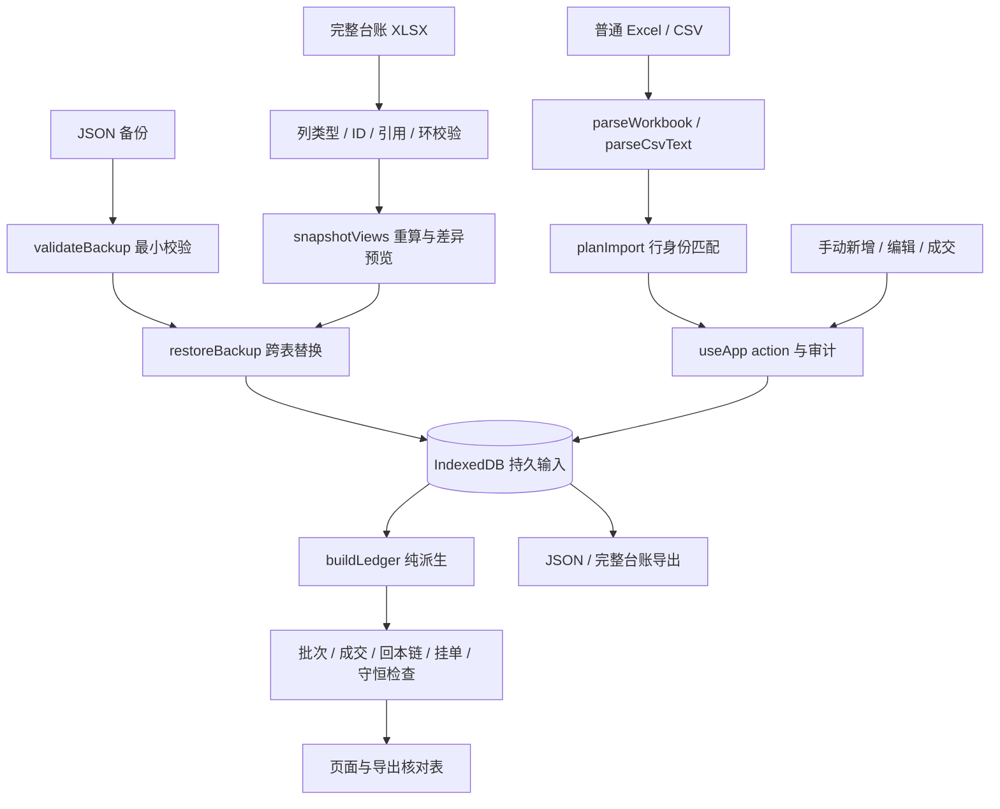

# 审计证据与复现

审计日期：2026-10-28。代码基线：`aa74bfd4032d485284f448447127f2bdfaf87dc4`。

本篇记录可重复的输入、操作、实际结果和验证边界，供综合审计报告引用。它不是修复记录，也不代表这里列出的问题已经解决。业务判断优先采用 `AGENTS.md` 的“当前优化口径”，历史文档中已被替代的说明不能用来反驳现行规则。

源码定位均为上述基线的一基行号。后续修改后行号可能变化，应同时通过函数名和对应探针重新定位。

## 1. 如何理解验证结果

本轮将证据分成四种，避免把“现有测试通过”解释成“所有场景正确”。

| 标记 | 含义 | 能支持的结论 |
| --- | --- | --- |
| 原有回归通过 | 原有单测或 E2E 的断言全部成立 | 已覆盖的场景没有检测到回归 |
| 已复现问题 | 在最小输入或真实 store/IndexedDB 中观察到偏差 | 至少存在一个确定可达或可输入的错误场景 |
| 规则待明确 | 实际行为已知，但缺少唯一、明确的业务预期 | 需要先确定语义，不能直接按作者偏好修改 |
| 未验证风险 | 源码显示存在薄弱点，尚未构造运行证据 | 可安排后续验证，不能写成已发生故障 |

**探针里的 `PASS` 只表示“指定观察或对照成立”，不表示缺陷已修复。** 例如，一个断言确认“2 条输入最后只落 1 条”时，`PASS` 表示成功复现了丢行。部分探索脚本只输出 JSON，进程退出码 `0` 表示探针运行完成，也不表示产品通过逻辑验收。

### 1.1 原有验证基线

| 验证 | 命令 | 本轮结果 | 归档日志 |
| --- | --- | --- | --- |
| 单元与 fixture 回归 | `npm test` | 28 个测试文件、372 项通过 | `audit/2026-10-28/results/unit.log` |
| 移动端冒烟 | `node e2e/smoke.mjs http://127.0.0.1:5173` | 477 项 `PASS`、最终 `E2E PASS` | `audit/2026-10-28/results/smoke.log` |
| 真实记账回归 | `node e2e/accounting.mjs http://127.0.0.1:5173` | 64 项 `PASS`、最终 `ACCOUNTING E2E PASS` | `audit/2026-10-28/results/accounting.log` |

这三组结果与下文已复现问题同时成立：原有测试主要验证既有正向流程，本轮增加的是导入歧义、撤销依赖、跨操作组合和异常文件输入。守恒式也只检查其定义的关系，不能替代身份、可达性、来源归属和恢复完整性检查。

### 1.2 隔离方式与重放

持久化探针使用独立 Chrome 临时 profile、CDP 端口 `9555`，访问本地 Vite `5173`，加载真实 `AppProvider`，经公共 action 调用真实 Dexie/IndexedDB。它与原有 E2E 的 `9444/9445` 及用户日常浏览器数据隔离。脚本结束时关闭自己启动的浏览器并尝试清理临时 profile。

从项目根目录运行：

```powershell
npm run dev
# 另一个终端执行：
node audit/2026-10-28/persistence.mjs
```

当前原始证据：

- `audit/2026-10-28/persistence.mjs`：实际可执行操作，共 15 个命名观察，归并成 D01～D11。
- `audit/2026-10-28/results/persistence-results.json`：最后一次运行的结构化实际结果。
- `audit/2026-10-28/results/persistence-findings.md`：专项分析底稿。

这些文件已正式归档到 `audit/2026-10-28/`。`results/` 保留当次静态证据；归档脚本重放结果写入被 Git 忽略的 `.tmp/audit-replay/`，避免覆盖原始结果。运行环境与完整命令见 `audit/2026-10-28/README.md`。下文观察名不依赖文件位置。

## 2. 输入、派生与引用关系

### 2.1 业务输入图



最需要保持的性质是：普通业务动作执行完成后，持久输入仍能经相同版本程序导出并恢复；每次删除来源，所有直接与间接引用都必须有明确去向。单次 `buildLedger` 不报错不等于输入图合法。

### 2.2 操作依赖表

| 输入对象 / 关系 | 引用方向 | 当前保存或派生方式 | 撤销 / 删除必须考虑 | 本轮发现 |
| --- | --- | --- | --- | --- |
| 真实子卖出 | `records.soldLotId → lot:<记录ID>` | 子行落库，批次派生 | 活跃子卖出、软删除后仍可恢复的子行 | 原有活跃依赖保护存在；历史依赖需统一 |
| 回补子卖出 | `records.soldLotId → lot:exec:<成交ID>` | 子行落库，回补批次派生 | 回补成交被物理删后，历史子行不能失去解释 | D04 |
| 下一轮买入 | `records.nextRoundOfRow → 原记录ID` | 新买入落库，消耗来源额度 | 回滚原导入、软删恢复、额度防重复 | D03 |
| 回补成交 | `rebuyExecutions.sellExecId → sell:<记录ID>` | 成交落库，生成虚拟批次 | 子卖出、虚拟拆卖、相关计划 | D04、D05 |
| 拆卖档 | `extraTargets.lotId → 真实 / 虚拟批次` | 输入落库，待卖份额派生 | 删除真实来源与撤销虚拟来源都要处理 | D05 |
| 拆买档 | `buyTargets.sellRow → 卖出记录ID` | 输入落库，成交保存来源档 ID | 回滚来源、已成交档的历史身份 | 原有回滚清理存在；D11 审计缺口 |
| 人工挂钩 | `hedges.sellRow / items.row → 记录ID` | 人工输入落库，有效分配派生 | 源卖出、目标库存、空人工覆盖含义 | 原有清理与保护存在 |
| 人工链 | `chainLinks.anchorRow / memberRows → 记录ID` | 只存人工关系与结束时间 | 锚点删除、成员删除、保留结束状态 | 原有清理存在 |
| 批次合并 | `merges.rows → 记录ID` | 只影响展示分组 | 少于两行时散组，清合并计划 | 原有清理存在 |
| 计划 | `plans.refId → 行 / 档 / 聚合价格身份` | 仅展示、默认成交输入 | 精确来源与价格聚合身份不能混为一谈 | 部分身份可清理，D11 审计缺口 |
| 导入批次 | `records.batchId → batches.id` | 新增行归属导入批次 | 回滚新增与已有更新的语义应区分 | 下一轮关系遗漏见 D03 |
| 审计 | `auditLogs.entityId → 历史实体身份` | 历史留痕 | 实体删除后仍应可解释，不宜当活动外键清空 | D02、D11 |

这里的“历史依赖”不是让所有已删除对象永久阻止操作。可采用归档、逻辑撤销、保留来源墓碑或明确的历史清理，但必须先选择统一语义，再使写库与恢复验证一致。

## 3. 持久化问题证据索引

| 编号 | 优先级 | 观察名 | 核心结果 |
| --- | --- | --- | --- |
| D01 | P1 | `nakedSellReimportSubset`、`reimportExistingKeyPublicAction` | 重导原样 B，改写了 A |
| D02 | P1 | `parallelManual` | 两次新增同主键，2 次成功仅 1 条记录 |
| D03 | P1 | `rollbackNextSource` | 回滚原批次留下下一轮悬空引用 |
| D04 | P1 | `undoRebuyAfterUndoSale` | 合法撤销顺序使自身 JSON 无法恢复 |
| D05 | P2 | `undoRebuyLeavesVirtualTargets` | 虚拟批次拆卖残留使完整 XLSX 无法往返 |
| D06 | P1/P2 | `jsonDuplicateIds`、`jsonCycleInvisible`、`jsonInvalidFields`、`jsonMissingRewardQty` | JSON 宽松校验可丢行、漏账、传播 NaN |
| D07 | P2、兼容语义需决策 | `restoreMissingTables` | 缺表恢复保留记录却清执行，已回补变欠股 |
| D08 | P2 | `invalidImportDate` | 2 月 30 日被进位为 3 月 2 日 |
| D09 | P2 | `fractionalImportQty` | 500.5 股无异常、无失败检查 |
| D10 | P2 | `excel1904Dates` | 1904 日期系统偏移 1462 天 |
| D11 | P2 | `missingAudits` | 计划、拆档与股票配置写入后审计仍 0 |

优先级是修复顺序建议：P1 涉及来源身份、持久数据覆盖、静默漏账或备份恢复可靠性；P2 涉及特定输入、展示/追溯完整性或需要先澄清的兼容语义。并非宣称所有用户当前台账都已经受影响。

## 4. D01：裸卖子集重导改写另一笔交易

**源码**：`src/domain/importPlan.ts:30` 的 `identityKeyOf`、`:76` 的 `planImport`、`:95` 的身份队列 `shift`；`src/store/useApp.tsx:397` 读取现有记录、`:400` 规划、`:422` 写事务。

### 4.1 精确输入

两行同为 T 股票，`buyDateSerial`、`buyPriceCents`、`buyQtyRaw` 均为 `null`，`soldQty=500`，没有子卖出来源：

| 记录 | sourceRow | importKey | targetPriceCents | sellDateSerial |
| --- | --- | --- | --- | --- |
| A | 2 | `sell-A` | 700 | 46010 |
| B | 3 | `sell-B` | 800 | 46020 |

先通过 `commitImport` 导入 A/B，再仅导入与本地 B 完全相同的 B。B 的 `importKey`、卖出日期、卖价、股数均不变。

### 4.2 期望与实际

期望：B 被精确匹配为无变化，A 保持 700 分。实际：返回 `added=0, updated=1, duplicated=0`，A 的卖价变为 800 分、卖出日期变为 46020，B 保持 800 分。

```text
导入前：[[2,"sell-A",700],[3,"sell-B",800]]
导入后：[[2,"sell-A",800],[3,"sell-B",800]]
```

可检查的观察断言是“第二次导入更新了 sourceRow=2，而不是精确命中的 sourceRow=3”。两个裸卖的买侧身份都成为 `T|||`，算法直接取该队列第一笔，没有先做精确内容键匹配。即使界面提示成功，也可能把 A 的真实成交事实替换成 B 的事实。

**修复验收**：先消耗精确匹配；剩余同身份多行只有在唯一可解释时才能自动更新。需覆盖裸卖子集、重排、买侧相同的多笔交易、确实修改卖出侧的同步，以及完全重复的合法多行。不能简单把同买侧身份全部去重。

## 5. D02：并发手动新增产生同主键并静默覆盖

**源码**：`src/store/useApp.tsx:632` 事务外读全表、`:633`～`:634` 分配主键、`:640` 开写事务、`:641` 用 `put`。UI 入口 `src/pages/TradesPage.tsx:631` 和新增保存按钮 `:1397` 没有在途保存保护。

在空记录库执行：

```javascript
await Promise.all([
  app.addManualRecord({
    kind: 'buy', stockName: 'T', date: '2026-10-20', price: '5', qty: '500'
  }),
  app.addManualRecord({
    kind: 'buy', stockName: 'T', date: '2026-10-20', price: '6', qty: '700'
  })
])
```

| 指标 | 期望 | 实际 |
| --- | --- | --- |
| 返回主键 | 两个不同 ID，或明确拒绝一个 | `[100000,100000]` |
| 记录数 | 2 | 1 |
| 买入股数 | 1200 | 700 |
| 保留价格 | 5 元及 6 元 | 仅 6 元 |
| 新增审计 | 与实际成功记录一致 | 两条“新增买入”，都指向 `record:100000` |

这是并发调用真实公共 action 的运行结果；没有通过直接写库制造主键碰撞。它证明 store 层没有并发安全性。双击、键盘与按钮交叠、多标签是否产生同样实际时序，仍可进一步通过 UI 验证；本轮不把未执行的时序路径算作独立证据。

**修复验收**：在同一记录写事务内分配身份并 `add`，或使用无碰撞稳定身份；UI 锁只能减少重复操作，不能替代写库一致性。相邻的 `commitImport` 同样在事务外规划并用 `bulkPut`，属于需要追加验证的同类风险。

## 6. D03：回滚导入遗漏下一轮依赖

**源码**：`src/domain/dependencies.ts:3` 只按 `soldLotId` 收集活跃依赖；`src/store/useApp.tsx:454`、`:460` 回滚校验；`:508` 物理删原行；`src/domain/backup.ts:228`～`:230` 拒绝悬空 `nextRoundOfRow`。

按以下顺序调用公共 action：

1. 导入 sourceRow=2：T，500 股，买价 500 分，卖价 700 分，买日 46000、卖日 46010，P 为空。
2. 用 `recordBuySuggestion` 执行下一轮：来源 `{kind:'next', id:'buy:2', row:2, qty:500}`，买 500 股，500 分，`2026-10-25`。
3. 对第 1 步生成的批次执行 `rollbackBatch`。
4. 导出 JSON，调用 `validateBackup`。

实际第 3 步成功删除 1 条原始记录；新买入仍为 sourceRow=100000、500 股，保留 `nextRoundOfRow=2`。第 4 步返回：

```text
records[0].nextRoundOfRow 指向不存在的行 2
```

观察断言：`rollbackCount===1`、剩余记录含 `nextRoundOfRow===2`、不存在记录 2、备份验证非空错误。对这种已有下一轮依赖的来源，应在回滚之前阻止或按明确历史策略处理，不能留下违反自身恢复校验的输入。

**修复验收**：覆盖活跃与软删除下一轮；原批次内依赖和批次外依赖；重新导入复用行号；回滚后 JSON/XLSX 自身往返。删除 `nextRoundOfRow` 会抹掉消费额度与追溯，不能把它当作无条件修复。

## 7. D04：撤销回补后，软删除子行的引用悬空

**源码**：`src/store/useApp.tsx:804`～`:808` 的 `removeRebuy` 只阻止未删除子卖出；`src/domain/backup.ts:215`～`:225` 对所有 records 验证来源引用，包含软删除行。

实际步骤：

1. 新增 T 裸卖 500 股，7 元，回补价 5 元。
2. `recordRebuy` 买回 500 股，5 元、奖励 0。
3. 对 `lot:exec:<该成交ID>` 记卖出 500 股，7 元。
4. `softDelete` 第 3 步子卖出。
5. `removeRebuy` 第 2 步回补。
6. `restoreBackup(await exportBackup())`。

第 5 步允许执行，执行表变空；第 4 步软删除行仍保留原 `soldLotId`，且这个虚拟批次已没有可重建的成交。第 6 步拒绝：

```text
备份内容校验失败：records[1].soldLotId 指向不存在的回补成交 lot:exec:<原成交ID>
```

这是按“先处理后续成交再撤销回补”能够到达的状态。问题不是坏文件被正确拒绝，而是正常公共操作已经制造坏文件，自己导出的全量备份无法由自己恢复。

**修复验收**：选择统一的历史保留或来源墓碑策略，在同一事务内处理所有引用。只在验证器里跳过软删除行不足以解决它，因为恢复该子行时仍需解释其真实成本和来源。需测试软删恢复、再次回补、原成交ID不复用，以及 JSON/XLSX 全量往返。

## 8. D05：撤销回补没有清理虚拟拆卖档

**源码**：`src/store/useApp.tsx:804`～`:821` 的事务未处理 `extraTargets` 或计划；`src/io/ledgerWorkbook.ts:262`、`:265` 严格验证拆卖来源批次。

在 D04 的第 2 步之后，不卖出，改为：

```javascript
await app.addExtraTarget('lot:exec:' + executionId, 600, 200)
await app.removeRebuy(executionId)
const snapshot = JSON.parse(await app.exportBackup())
await parseLedgerWorkbook(await exportLedgerWorkbook(snapshot))
```

实际仍有 1 条 `extraTargets`，价格 600 分、股数 200、`lotId` 指向已消失的回补批次。完整 XLSX 可以导出，但再解析时拒绝：

```text
买单拆卖 <分档ID>：批次ID lot:exec:<原成交ID> 不存在
```

D04 是软删除历史引用，D05 是活动拆档输入引用，两者不要混作同一种修复。D05 未涉及子卖出，撤销成交本应能安全清理其未成交配置。

**修复验收**：将虚拟批次的拆档、可识别计划和历史来源统一纳入依赖/清理图；撤销后不得误删其它批次或聚合价格身份的计划。增加“拆档→撤销来源→导出→解析→恢复”的往返断言。

## 9. D06：JSON 与完整 XLSX 的校验强度不一致

**源码**：`src/domain/backup.ts:34` 的 records 最小字段校验；`:61` 的回补校验；`:288`～`:295` 总入口；`src/store/useApp.tsx:1317` 调用校验、`:1330` 用 `bulkPut`；完整 XLSX 额外检查位于 `src/io/ledgerWorkbook.ts:247` 的私有 `validateRelations`。

### 9.1 重复主键：2 行恢复成 1 行

两个记录价格、股数均合法，但都 `sourceRow=2`；第一行 `importKey='A'`、500 分、500 股，第二行 `importKey='B'`、600 分、700 股。

实际 `validateBackup` 返回 `null`，`restoreBackup` 成功，输入 2 行落库仅 1 行，保留 B、600 分、700 股。JSON 不拒绝重复主键，Dexie `bulkPut` 的覆盖行为替用户决定了丢弃哪一笔。

### 9.2 循环来源：记录存在但均未进入成交与库存

两个记录分别 `sourceRow=2, soldLotId='lot:3'` 与 `sourceRow=3, soldLotId='lot:2'`，数值及基础字段合法。

实际 JSON 验证返回 `null`。`buildLedger` 的可达性计算没有根，结果 `records=2, lots=0, sells=0`，失败检查为空；相同输入经完整 XLSX 解析明确拒绝“卖出来源批次形成循环引用”。这说明“外键指向存在ID”还不够，还要检查图合法性和可达性。

### 9.3 字段类型：字符串价格导致金额 NaN

合法持仓记录只把 `buyPriceCents` 改成字符串 `'wrong'`，买入 500 股、目标 700 分。JSON 验证返回 `null`，`buildLedger` 买入金额、待卖预期收益成为非有限数字。

结构化证据里的这两个字段显示为 `null`，是 JSON 序列化 NaN 的表现，不代表领域函数把它们按缺失值处理。这里只证明数值污染，**没有证明页面白屏**。

### 9.4 必需业务字段缺失：rewardQty 传播 NaN

对一笔裸卖 500 股，构造回补对象：`qty=500, priceCents=500, at` 为有限时间戳，order/sell/stock/group 身份齐全，但不提供 `rewardQty`。

JSON 验证返回 `null`；订单 `doneRewardQty=NaN`，显式 `Number.isNaN` 断言为 `true`，预算检查显示 `NaN / 0 分`。这不是合法“奖励为0”的等价写法：兼容旧版本如需补0，应在迁移步骤明确定义。

**修复验收**：JSON 与 XLSX 都先迁移到统一完整 schema，再调用共享纯函数校验类型、范围、安全整数、唯一键、ID一致性、外键和依赖环。必须保留旧版缺新增表的兼容，但不能以兼容为由接受重复记录主键、错误类型或循环引用。

## 10. D07：部分 JSON 恢复混合了两种替换语义

**源码**：`src/domain/backup.spec.ts:13` 明确测试“空对象也通过”；`src/store/useApp.tsx:1328` 只在存在 records 时替换，`:1336`～`:1356` 却无条件清空执行、关联和审计。

因此，“允许部分旧备份”是现有设计；本项不应表述为“所有缺表旧备份都应拒绝”。风险是缺表恢复如何与当前库合成没有统一语义。

实际输入为最小 `{}`。恢复前本库 1 条裸卖、1 笔500股回补，已回补；恢复后记录数仍 1，但回补数 1→0、订单重新欠500股。计划、拆档、人工挂钩、链、合并、审计也走无条件清空分支。

| 指标 | 恢复前 | 恢复后 |
| --- | --- | --- |
| records | 1 | 1 |
| rebuyExecutions | 1 | 0 |
| 原订单欠股 | 0 | 500 |

**修复验收**：先区分“完整恢复”与“显式局部合并”。旧版缺后来才增加的表可以迁移为空，但其版本必需的根数据必须符合要求；若允许局部合并，则关联表的保留、替换和交叉验证必须对合成后的完整库执行。UI 已有恢复前自动导出当前快照，可以降低误操作损失，不能消除语义混用。

## 11. D08：普通导入把非法日期进位为另一天

**源码**：`src/io/parseWorkbook.ts:98` 的 `dateOrNull`、`:115` 的 `Date.UTC`；手动入口的严格反解校验在 `src/domain/edit.ts:49`～`:66`。

输入 CSV：

```csv
股票,日期,买入价,买入份额
T,2026-02-30,5,500
```

实际 `parseCsvText` 记录日期为序列 `46083`，`serialToIso` 显示 `2026-03-02`；手动 `isoToSerial('2026-02-30')` 返回 `null`。观察断言是同一个非法日期两个入口给出不同结论，普通导入还悄悄改变日期。

日期可能影响买卖先后、自动高位匹配和链时间范围，不能只把它视为格式问题。本轮未将其继续组合成具体错归链案例，不应宣称已经验证所有后续影响。

**修复验收**：统一严格日期解析；非法日期拒绝或作为缺失并报告原输入与原因。覆盖闰年、大小月、斜杠/点号、序列日期含时间小数，以及无缓存 TODAY。不能用自动进位作为纠错。

## 12. D09：普通导入接受小数股数，且未报异常

**源码**：`src/io/parseWorkbook.ts:82` 的 `numOrNull` 只要求有限数，`:164`、`:165` 直接用于股数；`src/domain/ledger.ts:103` 直接采用原始买入量。

输入：

```csv
股票,日期,买入价,买入份额,目标售价
T,2026-10-20,5,500.5,7
```

实际 `buyQtyRaw=500.5`，总买入 `buyQty=500.5`，`anomalies=[]`，失败 `checks=[]`。手动输入和完整 XLSX 都要求整数股，普通导入形成了较弱入口。

**修复验收**：普通导入也验证非负/正安全整数，按字段允许空值、0或公式推定，不能自动四舍五入真实股数。增加小数、负数、科学计数法、超安全整数和超卖组合，并核对“结构错误”与“可导入但业务异常”的区分。

## 13. D10：普通 XLSX 忽略 1904 日期系统

**源码**：`src/io/parseWorkbook.ts:222`～`:238` 未按工作簿 `date1904` 统一日期；`src/domain/defaults.ts:47`、`:49` 固定1900系统基准。

最小工作簿使用真实 SheetJS 编解码：

```javascript
const wb = XLSX.utils.book_new()
wb.Workbook = { WBProps: { date1904: true } }
XLSX.utils.book_append_sheet(wb, XLSX.utils.aoa_to_sheet([
  ['股票', '日期', '买入价', '买入份额'],
  ['T', 44853, 5, 500]
]), 'S')
```

该工作簿的44853按1904系统表示 `2026-10-20`；普通解析仍原样存44853，后续按1900系统显示 `2022-10-19`，偏移1462天。

**修复验收**：普通XLSX按工作簿属性标准化日期；CSV数值日期仍需明确自身规则。完整台账已经声明使用1900序列格式，不应与任意外部工作簿属性混用。需同时确认1900文件和文本日期不发生额外偏移。

## 14. D11：计划、拆档、股票配置未写审计

**源码**：`src/store/useApp.tsx:826`～`:879` 计划/拆卖/拆买增删；`:666`～`:677` 股票排序/启停；`:1209`～`:1223` 股票配置增改删。现行 `AGENTS.md` 声明所有数据变更经 action 自动写审计。

真实 action 序列：空审计 → `setPlan('buy','some-ref',500,200)` → `addExtraTarget('lot:2',700,200)` → `addBuyTarget(2,500,200)` → `updateStock` 把 T 间隔由200分改300分。

实际审计数量 `before=0, after=0`。这些输入变化可能改变有效挂单和派生目标，但无法通过操作历史解释。计划和拆档引用在本探针里是直接公共 action 输入，不用于证明它们通过正常 UI 的引用校验；“未写审计”的结论对任何合法引用的同一写分支仍成立。

**修复验收**：业务数据输入每次增删改与其审计在同一事务提交，明确记录稳定实体、来源、旧值、新值。UI纯偏好可以在规则里明确排除；恢复原有审计不应为了生成新审计而破坏旧ID。动作失败不得留下成功审计，数据成功不得遗漏审计。

## 15. JSON、普通导入与完整 XLSX 验证对照

| 能力 | 普通 Excel/CSV | JSON 备份恢复 | 完整台账 XLSX |
| --- | --- | --- | --- |
| 基础字段识别 | 表头别名、空值、缓存公式标记 | 少量必需字段检查 | 固定表列与类型校验 |
| 非整数股数 | D09 已证接受 | 多数只查有限数或未查 | 安全整数检查 |
| 严格日期文本 | D08 已证非法日期进位 | 未全面检查记录日期类型 | 日期序列要求有限数；文本不作为普通交易日期解析 |
| 日期系统 | D10 未按1904标准化 | 内部序列按1900语义 | 文件说明固定1900语义 |
| 主键唯一 | 解析物理行号自然唯一，身份匹配仍有D01 | D06重复ID接受并覆盖 | 重复记录/对象ID拒绝 |
| 外键存在性 | 写库规划与后续业务保护 | 检查多类真实行与虚拟子卖出引用 | 在JSON基础上加ID/股票一致性与虚拟拆档等 |
| 依赖环 | 普通格式无soldLotId列 | D06互引接受 | 卖出来源循环拒绝 |
| 跨链成员唯一 | 普通格式不表达人工链 | 未完整验证 | 多链重复成员拒绝 |
| 非空/空覆盖父关联 | 普通格式不表达 | 按对象结构恢复 | 父/成员分表，保留空人工覆盖 |
| 公式 | 部分无缓存公式按既有口径推定 | JSON无公式语义 | 原始输入表拒绝公式 |
| 缺新增表兼容 | 不适用 | 允许缺表；存在D07混合替换 | 已知版本与必需工作表严格检查 |
| 恢复前重算差异 | dry-run仅解析文件，不等于合并后完整账 | 无完整核对表预览 | snapshotViews与导出快照逐表比较 |
| 事务写库 | commitImport数据与审计同事务，但规划在外 | 跨表写事务 | 最终复用restoreBackup跨表事务 |

完整 XLSX 较严格不表示它已经覆盖所有领域语义。例如它验证“指向的记录存在”与一些ID/股票关系，但不能仅凭这些推出成交时间、来源可用量、所有奖励预算或归属都符合业务。它最终调用同一派生引擎；引擎里的逻辑问题仍会反映到重算结果中。

## 16. 其它专项证据入口

本篇聚焦持久化复现。其它专项由对应探针维护，综合结论应以主报告为准。

| 专项 | 当前证据位置 | 重放方式 | 主要验证接口 |
| --- | --- | --- | --- |
| 回本链与覆盖 | `audit/2026-10-28/chains.ts`、`results/chains-results.md` | `.\node_modules\.bin\vite-node.cmd audit/2026-10-28/chains.ts` | 真实 `buildLedger` 与链/覆盖字段 |
| 链性能 | `audit/2026-10-28/perf.ts`、`perf-large.ts` | 用 vite-node 分别运行 | 合法合成数据、多次计时，不是生产 SLA |
| 买建议纯函数 | `audit/2026-10-28/orders.ts`、`results/orders-pure-results.txt` | `.\node_modules\.bin\vite-node.cmd audit/2026-10-28/orders.ts` | 分类、计划、来源贡献 |
| 真实挂单与成交 | `audit/2026-10-28/orders-ui.mjs`、`results/orders-ui-results.txt` | `node audit/2026-10-28/orders-ui.mjs http://127.0.0.1:5173` | React页面、store、IndexedDB |
| 合并计划成员 | `audit/2026-10-28/plan-members-ui.mjs`、`results/plan-members-ui-results.txt` | `node audit/2026-10-28/plan-members-ui.mjs http://127.0.0.1:5173` | 公共action设置成员计划，真实UI成交及来源扣量 |
| 主线程边界观察 | `audit/2026-10-28/numbers-and-statistics.ts`、`results/numbers-and-statistics-results.json` | 用 vite-node 运行 | 金额、导入及其它纯函数 |
| 页面与更新 | `audit/2026-10-28/statistics-ui.mjs`、`pwa-update.mjs`及对应 `results/` JSON | 见脚本参数与主报告 | 独立浏览器的DOM与PWA行为 |

浏览器脚本使用不同端口，但不应在同一个端口重复启动两个副本。应先阅读对应脚本的端口、来源URL和临时profile处理，再重放。审计过程重放也应持续使用隔离数据，避免把探针引入用户实际台账。

## 17. 已验证保护与未验证边界

### 17.1 应保留的保护

- `recordLotSales`、`recordBuySuggestion`、`recordRebuy` 使用 `LEDGER_TX_TABLES()`，事务内 `currentLedger` 重算、校验实际剩余额度，数据和审计一起提交。
- `exportBackup` 对业务表使用跨表只读事务；`restoreBackup` 对替换数据使用跨表写事务。D06/D07是输入/语义不足，不是证明这些事务没有原子性。
- 完整 XLSX 使用固定ID与原始顺序，人工关联父子分表，自动关系只导出核对快照；解析有结构与引用保护。
- 现有活跃子卖出、父记录编辑、回补撤销与库存超额保护，以及对应64项真实记账回归均存在。本轮发现的是遗漏关系或交叉场景。

### 17.2 尚未完成的验证

| 边界 | 当前状态 | 不应宣称 |
| --- | --- | --- |
| 浏览器崩溃、强制断电、配额失败 | 未做故障注入 | 任何故障都可恢复，或已复现半清库 |
| resetAll多个独立clear | 源码确认未包统一事务 | 已发生持久库部分清空 |
| 多标签并发、跨设备合并 | 未完成专门运行 | 已验证跨标签一致性或同步 |
| 所有导入并发与编辑竞态 | 源码有事务外校验；手动并发已复现 | 每种action均已证明覆盖 |
| NaN导致页面白屏 | 未证实白屏 | 这些输入必然白屏 |
| 大文件资源耗尽与恶意压缩包 | 未测 | 已完成安全渗透或全部文件鲁棒性 |
| 所有历史版本迁移 | 已有部分兼容单测；未枚举全部历史真实备份 | 任意旧备份都可无损恢复 |
| 用户当前真实台账 | 本轮使用fixture与隔离合成输入 | 已检查用户本机全部交易数据 |
| 修复后的行为 | 本轮不修业务代码 | 缺陷已修复、回归已锁死 |

## 18. 建议的后续验收断言

修复时应把探索探针转换为正式、确定性的行为回归，断言正确行为而不是继续断言缺陷。至少包括：

1. **身份不串单**：原样重导任意子集，其他交易的价格、日期、主键、importKey均不变。
2. **并发不丢数据**：并发新增返回不同身份且总股数、金额、成功审计一一对应。
3. **活动图与历史图均合法**：任何允许的删除/撤销/回滚之后，全量备份仍可恢复；可恢复软删除行必须有合法来源解释。
4. **全量往返**：JSON恢复前后规范化输入相等；完整XLSX恢复前后输入与派生核对相等；合法操作产生的快照不能自我拒绝。
5. **入口同口径**：手动、普通导入、JSON、完整XLSX对价格、股数、日期和必需字段的合法性有一致的规范化与可解释差异。
6. **检查具备完备输入**：记录不可达、重复ID或NaN不能因总量也变成0而“守恒全绿”。
7. **操作可追溯**：业务输入写入和审计同事务，成功与失败语义一致。
8. **版本可解释**：格式版本、schema版本、计算规则版本分离；旧文件重算差异能分辨来源于文件编辑还是程序口径升级。

这些是建议的验收目标，不是本轮已运行全部通过的断言。业务语义尚待明确的部分，应先记录决策，再据此写回归。
