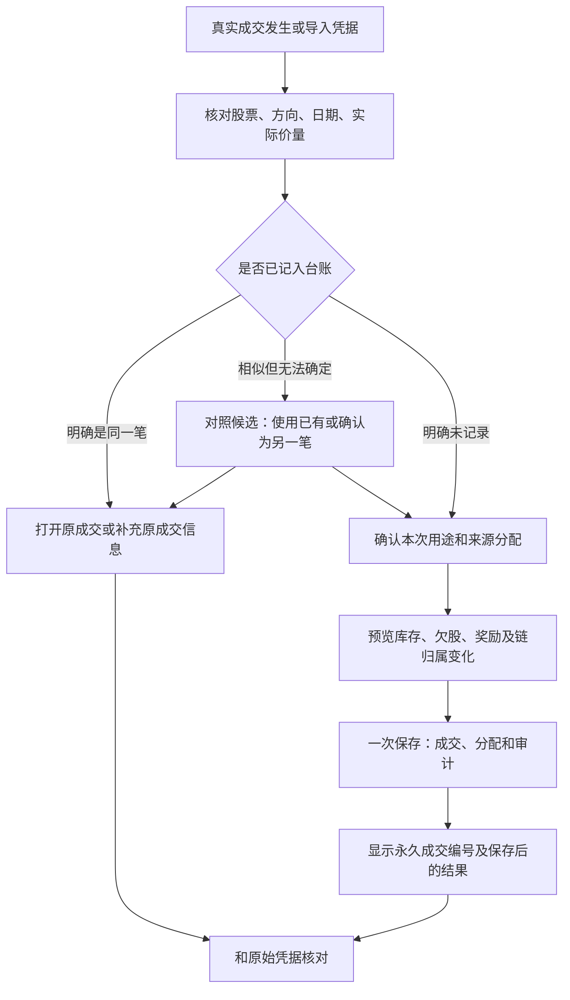

# 记账流程与防重改进建议

日期：2026-10-29。核查基线：`7964a3c`。本文保留最初改进方案，不能当作全部已实现的功能说明。首批防重、目的隔离、成交流水、凭据核对及整笔撤销已落地，当前操作与验证范围见[成交记录与核对](成交记录与核对.md)；任意关联既有成交、期初持仓等仍属后续方案。

## 1. 建议先解决什么

优先把“同一笔真实成交只记录一次、多个页面共同引用它”做扎实，再增加统计与自动化。当前多个入口分别保存原始行或回补成交，用户需要自己判断“这次买回该补买入、记回补，还是新增一笔”。页面又会在某些位置把计划回补价展示成买入价，容易产生“似乎已经买了 / 还没记上，再记一次”的误解。

建议明确四件事：

1. **事实**：哪天实际买卖了多少股，实际价格是多少，凭据是哪笔。
2. **计划**：下一步想在哪个价买卖，尚未成交不改真实账。
3. **分配**：一笔成交消耗哪些库存、覆盖哪些欠股、盈亏归哪条链。
4. **核对**：哪些事实已经和原始凭据对上，哪些仍有疑问。

同一成交同时“回补欠股”和“形成低位库存”，是同一事实的两个结果，不是两笔买入。高位成本分配也是同一卖出的归属视角，不能当另一笔卖出再统计。

## 2. 目前与防重、清晰度直接有关的情况

| 情况 | 当前证据 | 建议 |
| --- | --- | --- |
| 同一买回有补买入、回补成交、独立新增和导入等入口 | `TradesPage`、`OrdersPage`、`useApp` 现有调用 | 入口可以保留，但全部经过统一事实识别与分配流程 |
| 裸卖没有买入信息时，普通导入容易匹配到另一笔 | 已有 D01 实测；`planImport` 按买侧身份队列取第一笔 | 稳定身份优先，模糊匹配有歧义就等待选择 |
| 并发新增可能覆盖而非新增 | 已有 D02 真实数据库实测；事务外分配主键、事务内 `put` | 事务内分配并 `add`，唯一约束兜底；按钮防连点作为补充 |
| 剩余额度校验不是重复请求识别 | `recordRebuy` 每次调用生成新 UUID；额度够时两次部分成交都可能合法 | 为一次保存动作生成可重用的操作编号；重试返回原保存结果 |
| “新增并归链”分成两个保存步骤 | `TradesPage.onAdd` 先新增，再调用 `setChainMembers`；这里只做源码风险观察，未注入失败验证 | 事实、初次分配和审计原子提交；不能把关联失败提示成整笔未保存 |
| 明细卡可能用 P 列计划价填到“买”后面 | `TradeItem` 中 `buyP = buyPriceCents ?? earlyBuyPriceCents`，数量还可能取已卖量 | 没有买入成交就明确写“尚未买回；计划回补价×欠量” |
| 应买欠股与可选再买同价混组 | 已复现 O02；当前仍待修复 | 合并、计划身份与成交分配全过程保持目的隔离 |
| 合并建议缩量后来源未同步缩量 | 已复现 O04/O05；当前仍待修复 | 先算各来源贡献，再显示和提交；贡献量之和必须等于本次量 |
| 日历和树重复展示合成卖出次数/数量 | 已有 V01 页面实测 | 真实成交用唯一事实统计；成本分配详情另列 |
| 撤销、回滚留下来源或历史引用 | 已有 D03–D05 实测 | 先展示依赖影响，统一处理有效与历史引用，备份往返作为验收 |

这些问题不同：重复保存会多记股数，主键覆盖会少记股数，来源错配可能总量不变却归错记录，合成项重复只可能是展示重计。不能都用“删除相同记录”解决。

## 3. 推荐的日常步骤

### 3.1 初始化与后续交易分开

首次导入时标明这是“历史台账初始化”还是“本次新增成交”。初始化明确数据截至哪一天，此后已在应用录入的成交不能再由整份 Excel 当成新增重复导入。

若未来支持“期初持仓”，它是某个时点的余额，不能同时再计入对应的全部历史买入。期初余额缺少原始买入日时保留未知，不编造当天买入。现有 Excel 同行买卖记录可继续兼容，不要求立刻改成另一套表。

### 3.2 记录成交从“已发生什么”开始

普通买入入口先填写真实价量，再确认“新增独立持仓”还是“回补已有欠股”。从待买档进入则预选对应来源；允许补充或调整分配，不让用户在多个按钮间猜测。

卖出入口优先列出已有库存并显示可售量；只有确实需要先卖后买的记录才选择相应方式。避免卖出已有库存时误新增成无来源裸卖。

“补买入”建议改成明确选择：

- 这笔买回已经记过：选择已有成交进行关联，不再新增买入。
- 这笔买回尚未记录：填写并保存一次真实成交。

如果选择已有成交，只补充来源关系，不再增加买入量、不重复消耗奖励预算；有关关系修正仍需重新校验覆盖额度和依赖。

### 3.3 保存前显示本次影响

以“欠500股，本次5元买回200股，无奖励”为例：

| 核对项 | 确认页应显示 |
| --- | --- |
| 本次事实 | 柳工 · 买入200股 · 实际5.00元 · 金额1000元 · 真实成交日期 |
| 买入用途 | 基础回补200股；奖励0股；可选新增0股 |
| 欠股变化 | 500 → 300股 |
| 新库存 | 本次产生200股低位库存，来源为本次成交 |
| 原始亏损 | 不因买回价更低而消失 |
| 后续盈利 | 买回未卖出，本次不增加后续已实现盈利 |
| 来源 | 回补哪笔卖出、对应档位、涉及哪条链 |
| 已有记录候选 | 同股同日相似成交的编号与来源，供用户对照 |

“库存”和“覆盖欠股”是不同维度，不能把本次买入200股拆成“库存200＋回补200＝买入400”。真实现金流也只计算一次1000元。

对合并成交，建议默认展开各来源本次贡献。例如两档本次各100股，合计200；不能显示200而仍向写库层传入原来的200＋800股来源容量。

### 3.4 保存后给出明确回执

保存成功页显示“已记账：成交编号××，本次200股，仍欠300股，可查看本次库存”。后续从其它入口到达同一成交时直接显示这个回执。

如果数据库提交成功、页面刷新或附属动作失败，提示“成交已保存，页面刷新/后续处理未完成”，并能按操作编号找回结果。不能统一显示“新增失败”诱导用户再记一遍。

## 4. 让数据更明晰的页面改进

### 4.1 价格明确分为“实际”和“计划”

| 当前容易混淆的写法 | 建议写法 |
| --- | --- |
| 没买入却写“买8.01×500” | “尚未买回；计划回补8.01元，基础欠股500股” |
| 已卖记录继续称“目标售价” | “实际卖出价”；未卖剩余另列“计划卖价” |
| “已改单”但来源贡献不清楚 | “本次建议200股”，下方逐条列贡献，另标真实剩余额度 |
| 只写“已完成” | 明确“本笔卖出已完成 / 基础回补已完成 / 链已回本”，分别核对 |
| 把回补节省和利润放在一起 | 节省保留参考标签；实际盈利与链进度单独展示 |

E列双义可以在兼容层保留；移动端应按当前状态使用不同标签。P列再买、回补价、实际买价也不应共用“买入价”名称。

### 4.2 一张卡片先回答四个问题

卡片从上到下优先显示：股票与类型、真实买卖、尚待处理数量、下一步按钮。来源、成本归属、历史与追溯 ID 放入详情，不用技术 ID 作为首要阅读内容。

每笔保留三个不同身份：界面第N笔帮助查找；不可变内部ID维护关联；来源成交号识别真实事实。Excel物理行号和内容哈希不适合替代全部身份。

### 4.3 汇总至少区分这些数字

- **账面净持仓**：按真实买入和真实卖出核算；与待卖建议量分别解释。
- **尚欠基础股**：已卖而待回补的基础股，不把奖励或可选再买加进去。
- **其中未有库存交割的敞口**：是欠股的另一维度；挂住高位库存可使敞口为0，但仍未买回。
- **本次可选再买**：下一轮和可选P列再买，不能升级成必须回补。
- **实际成交盈亏与高位交割亏损**：按现行口径分项解释，再展示合计，不因重新分项擅改总账。
- **待卖预期与回补参考节省**：计划、参考，不计入已实现回本。

如果没有券商余额或银行流水接入，不应把按价格和股数推导的金额称为“可用现金”。费用尚未纳入时，现金对账不能承诺与券商账户一分不差。

### 4.4 增加统一成交流水和未核对列表

建议增加“成交流水”视图，包含普通买入、普通卖出和回补成交；不把虚拟批次、成本分配和链分支列为新的真实成交。先做只读统一投影，即可让用户看清一笔真实交易在哪些页面被引用。

增加独立的核对状态：“已记账待核对 / 已与凭据核对 / 待补信息 / 待处理冲突 / 已撤销”。核对状态与持仓、欠股、链状态分开，避免一个“已完成”同时承担多种含义。

“疑似重复”进入待处理列表，点击可比较两笔。没有核实前不合并、不自动删除，也不让导入冲突静默落账。

## 5. 防重必须同时做的三层措施

### 5.1 同一次保存请求的重复：幂等提交

表单创建一次保存操作时生成操作编号，按钮连点、网络/页面重试和多入口继续同一草稿时复用它。编号、成交、分配和审计在同一事务提交。

相同操作编号和相同内容再次提交，返回原来的成交结果；相同编号却提交不同价量，明确报冲突。**每次点击都新生成UUID不能解决重试重复**，它只保证两条数据库记录ID不同。

按钮禁用、Enter防重复和保存中提示都应保留，但它们只是交互保护。数量没超上限也不能证明没重记——原欠500股、重复录入两次200股仍未超额，事实上可能只成交过一次200股。

### 5.2 多个入口录入同一现实成交：事实身份

优先使用来源凭据中可靠的成交编号，并按其真实唯一范围加命名空间；不是把某个字段想当然当作全局唯一。同一委托可能分多笔成交，委托号本身不足以识别每次实际成交。当前单一台账不因此重新引入账户功能。

人工录入没有外部成交号时，也先给事实分配永久内部ID；以后导入发现同一事实，允许把外部来源身份绑定到原ID，不新增一笔。一次真实成交分配到多个库存批次时，应有一个父成交事实和多条分配明细，不把每条成本分配当成新的券商成交。

不能仅以“股票＋方向＋日期＋价格＋数量”建立强制唯一：相同条件下确实可能有两笔不同成交。它可用于提示候选；用户确认是另一笔时允许新增，并保留区别依据。

### 5.3 导入覆盖与并发：存储层约束

- 永久来源身份建立唯一约束，新增使用 `add`；更正已有记录是另一种明确操作，不能用 `put` 静默覆盖撞号记录。
- 若继续使用数字主键，分配主键与新增放在同一写事务，不在事务外先读最大值。
- 保存时在同一事务重读当前库存、欠股、奖励和修订信息，再校验本次分配，不信任旧页面缓存的额度。
- 导入、手动、回补、沙盒转正走同一底层校验与幂等入口；页面可有快捷入口，不能各自绕开防重。
- 跨标签更新提示失效状态或同步刷新；内存按钮锁不能当作多标签一致性的保证。
- 最终计数、来源唯一性、字段类型、引用和历史状态共同校验；JSON和完整Excel迁移后应进入同一核心校验流程。

以上是建议的保证目标；当前尚未整体具备。

## 6. 导入流程需要单独改造

### 6.1 一份导入预览必须解释将怎样改变当前台账

当前普通导入预览主要对“文件自己的记录”建账，不是把已保存成交、人工关系与导入计划合起来模拟最终状态。建议预览与实际提交调用同一份写入计划和派生计算，在确认前检查当前数据修订是否仍一致。

每条候选显示：原记录编号、文件行、来源身份、匹配依据、改前价量、改后价量、影响库存/欠股，以及涉及的后续成交。按以下类型分组：

| 分类 | 默认动作 |
| --- | --- |
| 已确认同一成交、内容相同 | 跳过，不新增、不生成第二条实际成交 |
| 同一稳定身份、仅补信息 | 列出补充内容及影响，确认后更新原事实 |
| 同一身份但价量等事实冲突 | 阻止静默覆盖，进入冲突核对 |
| 疑似相同但无可靠身份 | 给出候选，等待“使用已有 / 作为另一笔”选择 |
| 明确新增 | 计入新增预览 |
| 非法数据或悬空依赖 | 拒绝对应不合法提交并给出定位，不能半包写入 |

### 6.2 匹配优先级

先匹配永久ID/可靠来源成交身份，再处理唯一的旧兼容匹配。同内容键可帮助确认，但必须检查候选唯一性；同日同价同量两条合法成交不能被自动压成一条。

历史旧文件无稳定身份时，保留同身份多行的多重性，不因为排序或只导入子集就从队列取第一笔。多对多歧义进入人工核对，不能一边自动猜、一边宣称完全防重。

文件指纹只适合提示“这份文件导过”，不是跨文件的交易唯一身份。换文件名、CSV转XLSX、修改备注或只导出子集，不应绕过事实去重，也不应错误封锁真正的新交易。

### 6.3 历史更正和新增成交分开

已有Excel同一行可能表示某批次累计已卖数量，而新成交文件通常表示本次成交。导入先识别“累计状态更新 / 逐笔成交 / 完整恢复”三种用途，不能把累计700当成在原500之上再卖700。

累计更新700相对已有500，在含义确切时至多反映新增200；若已有独立子卖出或多次不同价成交，不能仅相减就编造一笔成交，应核对对应来源。缺列不等于清空列，既有保护应保留。

## 7. 撤销与纠错避免造成下一次重复

建议原始成交保留身份与历史，错误修正通过可追溯的撤销/更正表达；统计只计算有效事实。撤销后仍保留可识别的历史身份，重导同一旧凭据时提示“这笔已撤销”，而不是自动复活或无条件当新成交。

保存“更正旧事实”和“新增另一笔”时用户意图应分开。已确认的重复候选，只在对照原始凭据并解释后续库存/链/奖励影响后处理，不能依据金额相似直接删一笔。

撤销前展示依赖：子卖出、后续回补、下一轮来源、拆档、历史软删记录及链归属。明确哪些可以原子清理，哪些需要先处理；不要只拦活跃引用而忘记软删除历史。处理后立即验证自身导出的JSON与完整Excel仍可恢复。

## 8. 建议实施顺序

| 顺序 | 内容 | 完成标志 |
| --- | --- | --- |
| 第一批：事实安全 | D01导入歧义、D02并发主键；统一保存幂等；O02目的隔离；O04/O05贡献量 | 不错改/覆盖事实，不重复提交，不混淆欠股与可选量 |
| 第二批：看得明白 | 实际/计划标签；统一成交流水；保存前后影响回执；导入最终状态预览 | 用户无需猜入口或从多页拼出一笔交易 |
| 同期：依赖与归属 | D03–D06撤销/回滚/备份一致；C01–C03自动归属与多轮、结束边界 | 记录不丢、引用可解释、链不诱导用户重复补录 |
| 第三批：日常对账 | 原始凭据映射；待核对列表；V01真实次数统一投影；跨标签状态 | 每日新增事实与券商记录逐笔核对，不把显示重复误当多成交 |

“一次保存只记一次”应先有保障，再承诺更多自动匹配。不能用指南提醒代替数据层保证，也不必立即把全部旧记录改成新表结构。

## 9. 必须具备的验收场景

1. 同一保存动作连点、按Enter、刷新后重试或两个标签提交：相同操作编号只增加一笔，返回相同结果。
2. 两笔真正独立的同股同日同价同量成交：不同可靠身份可合法保存，提示不误删。
3. 先手工记录回补，再导入包含同一笔的文件：绑定到原事实，实际买入量只增加一次。
4. 同一成交分给两条欠股/两个库存来源：父成交量等于分配合计，现金流只算一次。
5. 欠500、本次买200：新增库存200、基础欠量减200；不能又产生独立买入200。
6. 两档各计划100合并成交200：各档恰扣100，来源贡献总和200，不按原容量200＋800扣档。
7. 欠股500和可选300同价及改单撞价：始终保持两组，旧歧义计划不能同时应用。
8. 普通文件改名、换格式、重排或只导子集：不能错更新另一笔；相同身份多条的合法次数保留。
9. 并发两笔不同新增：两个不同主键都存在，审计和保存回执一一对应。
10. 提交后模拟页面刷新失败、关联写入失败：用户能确定真实保存结果，重试不会再添事实。
11. 同一事实撤销后重导：明确显示撤销状态，未经选择不复活、不另建；后续依赖和备份合法。
12. 所有入口相同核心校验；库存/欠股/奖励/链与统一成交流水可追溯；合成成本分配不增加真实次数。

## 10. 现版本即可采用的操作习惯

- 初始化后选定一种日常记账主入口；同一笔买回在“补买入 / 回补成交 / 新增”中只用一次。要导入另一份已重叠的台账先核对预览。
- 卖已有库存优先从对应待卖档记卖出；不要再新增一笔无来源卖出来“补记录”。
- 成交保存后查看剩余量和实际回执，再进行下一笔；保存结果不明时先查已有记录，别立即重试新增。
- 每天将新增的真实买卖与原始成交凭据对照；总量正确仍需核对来源和分档。
- 回本卡不对先查归属；展示缺失不等于买入没记上，不能新增交易补链卡。
- 涉及重导、恢复、撤销或回滚前保留完整备份；正常操作习惯能降低触发概率，但不能替代上述待修复的存储保证。

## 11. 代码核查入口

以下为 `7964a3c` 的定位，便于实施前再次确认：

- `src/domain/importPlan.ts`：`identityKeyOf`、`planImport` 的身份队列匹配。
- `src/store/useApp.tsx:395`：`commitImport` 的计划与事务边界。
- `src/store/useApp.tsx:630`：`createManualRecord` 的主键分配和新增保存。
- `src/store/useApp.tsx:690`：`recordLotSales` 的来源分配。
- `src/store/useApp.tsx:719`：`recordBuySuggestion` 的多来源执行。
- `src/store/useApp.tsx:783`：`recordRebuy` 的新执行ID与剩余额度校验。
- `src/pages/TradesPage.tsx:623`：`onAdd` 的新增后归链。
- `src/components/TradeItem.tsx:55`：实际买价为空时使用P价显示。
- `src/pages/manage/ManageImport.tsx:54`：文件独立预览与冲突比较。
- 既有反例与范围：[项目逻辑审计](项目逻辑审计与优化建议.md)、[操作边界与核对](操作边界与核对.md)。
