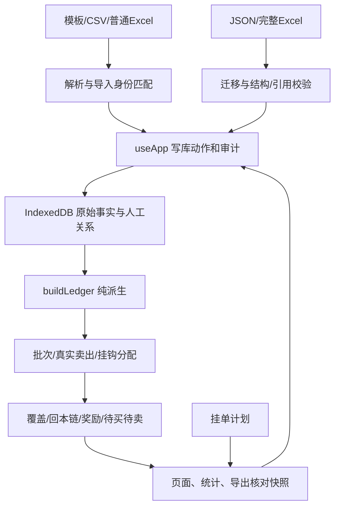

# 项目逻辑审计与优化建议

审计日期：2026-10-28。审计基线：`aa74bfd4032d485284f448447127f2bdfaf87dc4`。技术环境：Windows、Node.js 22.22.2、React 18、Dexie 4、本地独立 Chrome 测试环境。

**结论：基础账务架构和既有回归保护有效，但仍存在需要优先处理的逻辑问题。** 本轮按根因整理了 **26 个问题或观察项，其中 9 项列为 P1**。主要集中在自动回本链归属、买入建议隔离、导入身份和数据关系生命周期。另有统计、输入校验、审计记录及 PWA 更新问题。

本轮只新增审计文档及复现资料，**没有修改产品计算、数据库、正式测试或部署版本**。以下“应有结果”依据现行用户口径或已声明的产品行为；“实际结果”是基线代码的运行观察。兼容策略、资金策略等需要决策的地方单独标出，不能将建议冒充已确定需求。

## 阅读入口

- 本文：问题、影响、根因、修复方向、优化次序和验收要求。
- [网格交易场景与核对](网格交易场景与核对.md)：按业务操作查应有结果、算例、已知例外与待验证组合。
- [审计证据与复现](审计证据与复现.md)：验证环境、持久化专项证据、原有保护及校验强度比较。
- [复现资料说明](../audit/2026-10-28/README.md)：可运行探针和归档输出。探针中的 PASS 可能表示“成功观察到当前缺陷”，不表示已经修复。

## 1. 审计方法、范围和结论边界

本轮交叉核对了 `AGENTS.md` 的最新优先规则、使用手册、明细类型图鉴、先卖后买需求、完整台账 Excel 说明、领域源码、写库 action、页面调用及现有测试。专项分为链与覆盖、挂单与成交、导入与持久化、统计与运行机制四部分。

验证包含源码追踪、真实 `buildLedger` 最小输入、正反对照、真实 `AppProvider` 公共 action、独立临时浏览器中的 IndexedDB、真实页面操作和生产包 Service Worker 更新实验。测试浏览器使用新建临时 profile；没有读取或修改用户日常浏览器中的真实台账。测试数据为 T/U 等合成记录及项目已有 fixture。

| 证据级别 | 含义 | 可以得出的结论 |
| --- | --- | --- |
| 实测：纯函数 | 真实领域入口运行最小输入，有数值/断言 | 该输入下领域计算确实如此；不自动证明所有 UI 入口都能到达 |
| 实测：公共 action | 真正的 React store、Dexie 和公共写库动作 | 可以确认实际持久化结果；不把直接调用说成已点击全部 UI 步骤 |
| 实测：页面 | 实际渲染、点击、填表或读取页面/画布桥 | 可以确认该界面行为；需继续区分显示与真实账本 |
| 实测：生产包 | 本地 HTTP 提供真实生产构建产物 | 可以确认本地受控更新流程；不声称已覆盖所有手机浏览器 |
| 源码观察/待明确 | 看到了风险路径或规则不充分 | 优化或补验证候选，不能写成已发生的数据损坏 |

不包含穷举证明、真实券商成交对接、真实用户全库逐笔审计、Safari/iOS 真机、浏览器强杀/磁盘满故障注入、外部依赖安全扫描、交易费用及市场规则合规核验。项目当前“未扣费用”的盈利口径按既有设计保留；这次是软件账务逻辑审计。

### 1.1 既有验证结果

| 检查 | 本轮结果 | 能证明什么，不能证明什么 |
| --- | --- | --- |
| `npm test` | 28 文件、372 项通过 | 既有单测期望成立；部分旧期望本身与最新规则冲突 |
| `npm run lint` | 通过 | 静态规则无错误，不能证明金额/来源分配正确 |
| `GITHUB_PAGES=true` 下构建 | 通过 | TS 与生产产物生成成功，不能证明更新激活流程正确 |
| `e2e/smoke.mjs` | 477 项通过 | 已有页面场景成立，不包含本次所有组合 |
| `e2e/accounting.mjs` | 64 项通过 | 既有真实数据库记账场景成立，未穷尽撤销与归属路径 |
| 链专项 | 9 组观察/对照断言成立 | 复现 4 类链问题，并有人工归属、未知日期、次日结束等对照 |
| 其它专项 | 已归档逐项输出 | 含公共 action、页面、生产包实验；部分脚本以打印证据为主，退出码不是产品正确性结论 |

原 XLSX fixture 与真实 CSV 是不同的数据口径，不能混用预期：XLSX 已实现盈利 7970 元、待卖 15200 股、待买/敞口各 2000 股；CSV 识别 6 笔先卖后买、已回补 2100 股，仅源行 60 欠 500 股 @8.01，高位亏损合计 5176 元，后续完成盈利 0 元。源行用于复现；产品仍应以“第 N 笔”显示。

### 1.2 优先级

- **P1**：正常业务组合可能改变订单含义、丢失/错改原始事实、使备份不可恢复，或显著改变回本链结果，应优先修复。
- **P2**：确定的边界、展示、预算、输入或追溯问题；其中部分需要先明确产品策略。
- **待明确/待验**：不纳入已确认缺陷数量，不因代码看起来复杂就判错。

P1 不是“所有用户现在都已受影响”。例如 JSON 重复主键需要输入含重复 ID；并发新增需要两个新增动作重叠；自动亏损脱链需要已归属低位库存后来发生净亏损。以下均写明触发条件。

## 2. 当前模型与应保持的不变量

产品的重要区分：原始记录、实际成交、库存归属、可执行建议、展示聚合并非同一层。挂钩合成卖出是同一真实成交的成本分配视角，不能再增加成交次数；计划可以改变建议显示与成交默认值，不能倒改原始账；回补节省可以展示，不能当成已实现盈利。

| 编号 | 应保持的不变量 | 现有保护与缺口 |
| --- | --- | --- |
| I01 | 原始主键唯一；新增不得覆盖另一笔事实 | 并发分配与 JSON 恢复存在缺口，见 D02/D06 |
| I02 | 价格金额有限且为安全整数分，股数为安全整数 | 常规输入已有部分校验，普通导入与极端金额不足，见 D09/V05 |
| I03 | 净持仓 = 买入量 − **真实**卖出量 | 当前成立；这是定义性检查，不能单独独立证明账正确 |
| I04 | 待卖量 = 可生成目标的批次剩余；缺价必须显式异常 | 当前已有检查；缺价时不能靠补造价格把检查“修绿” |
| I05 | 待卖 − 敞口 − 覆盖扣减 = 净持仓 | 当前 cover 统一模型有效，但只约束股数总量 |
| I06 | 同行买入、独立真实覆盖、回补执行各扣一次 | 既有大量覆盖测试；归属重建仍可能使待买状态变动，见 C01 |
| I07 | 已归属库存不能因后来赚钱/亏钱改变身份 | C01 违反 |
| I08 | 后续卖出和回补沿来源份额继承；每份盈亏只归一条链 | C02 违反；基本历史多链 FIFO 有正确对照 |
| I09 | 链累计 = 原始亏损 + 归属后续已实现盈亏；回补节省不入进度 | 加法本身正确；输入归属与参考成本存在问题 |
| I10 | 结束保留已有归属，阻止之后新库存自动加入 | 精确时间在自动路径失效，见 C03 |
| I11 | 建议合并前已确定股票和业务目的；合并后仍同股同目的 | O01/O02 违反 |
| I12 | 建议实际贡献量之和 = 建议量；成员计划之和 = 用户计划量 | O04/O05 违反；容量与贡献量需分开 |
| I13 | 奖励的利润资金来源能用实际成交金额解释 | 当前可事后发现超支，成交前不足，见 O03 |
| I14 | 删除/撤销/回滚后，活跃及历史外键仍有合法解释 | D03/D04/D05 违反 |
| I15 | 本程序导出的合法完整备份可以被本程序再次恢复 | 正常路径有回归，但上述生命周期组合可破坏 |
| I16 | JSON 与完整 Excel 迁移后应满足相同核心数据约束 | D06 违反；两种文件格式可以不同，底层事实合法性不应不同 |
| I17 | 日期未知不猜回补；非法日期不悄悄换日 | 未知日期已有保护，非法文本与日期系统存在缺口 |
| I18 | 页面日/月/树的真实成交量与次数一致，成本分配只贡献盈亏 | V01 违反 |
| I19 | 业务输入变更及审计原子保存 | 关键成交已有实现；计划/拆档/配置等未覆盖，见 D11 |
| I20 | 已下载新版本只有在用户授权更新时接管，并能按提示完成 | 保留“不自动刷新”；当前“手动刷新生效”不可靠，见 V04 |

**检查全绿的正确解释：已实现的这些检查没有发现错误。** 本轮多条链缺陷、错档、重复页面成交、循环不可达记录都能与检查全绿并存。总量相等无法证明钱和股票归到了正确的记录、订单与回本链。

## 3. 问题索引

| ID | 级别 | 问题 | 证据 |
| --- | --- | --- | --- |
| C01 | P1 | 自动归属低位库存亏损后脱离原链，甚至重新欠股 | 纯函数及人工归属对照 |
| C02 | P1 | 自动槽第二代回补不继承库存和后续盈亏 | 多轮纯函数 |
| C03 | P2 | 同日结束之后的回补仍被自动归入旧链 | 精确时间输入、次日对照 |
| C04 | P2 | 实际回补价偏离 P 时，分支买价与参考节省仍用 P | 纯函数 |
| O01 | P1 | 当前选股混入其它股票买单 | 页面和公共 action |
| O02 | P1 | 欠股与可选再买跨目的合并，计划身份共享 | 纯函数、现行规则对照 |
| O03 | P2 | 改高实际成交价可使奖励花费超过利润预算 | 公共 action/IndexedDB |
| O04 | P2 | 计划缩量未缩来源贡献，合并成交扣错档 | 完整 UI 成交 |
| O05 | P2 | 合并计划总量小于成员数时静默扩大 | 页面 |
| O06 | P2 | 开启空沙盒丢弃真实建议级改单 | 页面 |
| D01 | P1 | 裸卖子集重导错改另一笔，精确键不优先 | 纯函数及公共导入 action |
| D02 | P1 | 并发新增分到同一主键，后一笔覆盖前一笔 | 公共 action/IndexedDB |
| D03 | P1 | 回滚导入遗漏下一轮依赖，自身备份失效 | 公共 action/导出校验 |
| D04 | P1 | 先软删子卖出再撤销回补，历史来源悬空 | 公共 action/实际恢复失败 |
| D05 | P2 | 撤销回补未清虚拟批次拆卖档，完整 Excel 失效 | 公共 action/XLSX 往返 |
| D06 | P1 | JSON 缺唯一性、数值和环校验，可能丢行/漏计/NaN | 多个正反输入、实际落库 |
| D07 | P2/需决策 | 部分 JSON 恢复混合保留旧记录与清空旧关联 | 公共 action |
| D08 | P2 | 普通导入非法日期被 Date 自动进位 | CSV 与手动入口对照 |
| D09 | P2 | 普通导入接受小数股数，无异常 | CSV/真实领域入口 |
| D10 | P2 | 普通 XLSX 忽略 1904 日期制，日期错 1462 天 | 构造真实 XLSX 解析 |
| D11 | P2 | 计划、拆档、股票配置等动作缺审计 | 公共 action/日志表 |
| V01 | P2 | 日历和价格树重复统计挂钩合成记录 | 实际页面/画布输出 |
| V02 | P2/口径 | 网格统计计入挂钩暂记，违背页面说明 | 领域函数及页面 |
| V03 | P2 | 趋势把未填日期当月桶，占位且空标签 | 实际页面 |
| V04 | P2 | PWA 新版本等待时，普通刷新未激活新版 | 生产包 A/B 更新实验 |
| V05 | P2/极端输入 | 超大数值可产生 Infinity 或不安全整数 | 金额与手动记录入口 |

以下按关联业务解释。源码行号均指审计基线，未来修改后以函数与稳定 ID 定位。

## 4. 回本链与库存归属

### C01：自动成员后来亏损，会被重新识别成亏损锚点

输入：10 元买 500 股，7 元卖出亏 1500 元，P=5；之后独立录入 5 元买 500 股，已自动归入原链；再明确从该低位批次 4 元卖 300 股。

| 时点 | 应有 | 实际 |
| --- | --- | --- |
| 低位买入后 | 原链持仓 500 | 500，正确 |
| 低位卖 300 后 | 原链后续盈亏 −300 元、持仓 200、累计 −1800 元 | 原链后续 0、持仓 0；另建低位亏损链 −300 元 |
| 总账 | 待卖 200、总盈亏 −1800 元 | 数字仍正确，所有 `ledger.checks` 通过 |

若根是默认高位关联的先卖单，该低位买入本来已覆盖根待买；低位亏损被抽走后，根还可能重新出现欠 500 股的买单。用户看到的可执行欠股状态会改变，影响不限链卡展示。

根因：[chain.ts](../src/domain/chain.ts) `436–450` 先将低位净亏损批次列为新锚点，`307` 排除锚点自动归槽；人工成员在建种子阶段有优先保护，自动成员没有。相同输入补 `memberRows=[低位行]` 后，原链后续 −300、持仓 200 正确。

修复方向：先解析库存来源和归属，再为未归属的独立亏损库存建链。归属不能依赖该库存后来恰好盈利还是亏损。验收必须同时检查链成员、持仓、盈亏及根待买是否复活，不能只检查全局总量。

### C02：自动成员卖出之后的下一代回补断链

输入：高位 10 元持仓 500；7 元先卖 500(P5)，自动挂高位；记首轮回补 `initial`，5 元 500；从 `lot:exec:initial` 7 元卖 500(P5)；为子卖出再记回补 `round2`，5 元 500。

第二轮买回后，总账真实持有 500 股，原链后续盈利 1000 元，但链持仓显示 0。再从 `round2` 8 元卖 500，第二轮盈利 1500 元应继续归原链，使后续盈利合计 2500、累计 +1000；实际原链仍只累计 1000、显示仍亏 500，而全局已盈利 1000。所有数量检查仍通过。

根因：`chain.ts:509–514` 的 `owners` 只覆盖部分路径；`584` 跳过已经由自动槽识别的首代回补，后面的递归只沿 `owners` 继承。自动槽展示收编和递归所有权之间断开。真实低位批次自动归槽再卖出/回补也存在同类问题。

修复方向：自动槽、人工成员、历史分链、执行递归使用同一份按股数的所有权。聚合链卡时再按槽展示，防止把同一笔盈利既在槽又在递归分支重复累计。验收至少覆盖两代、三代，实际价偏离 P、部分成交和共享回补。

### C03：结束时间在自动路径中被降为日期

12:00 人工结束，15:00 在同一天新增 5 元 500 股回补，执行记录有精确 `at`。应保留新库存但不归旧链，实际旧链持仓增加 500；改到次日则正确排除。

根因：`chain.ts:211–222、315` 将结束时间降为本地日期，自动槽接受同日库存；`584` 又绕过了 `614–616` 已有的精确时刻判断。普通 `recordRebuy` 与结束动作都写 `Date.now()`，实际 UI 路径可以触发。

修复方向：执行有精确时刻时必须比较精确时刻；只有交易日的原始记录，需明确结束当天包含还是排除。结束前已有归属库存在结束后卖出仍应累计，不能用“一律排除结束后卖出”代替修复。

### C04：计划槽价被展示成实际回补成本

10 元买 500→7 元卖，P=5，实际 5.50 元回补 500。真实批次成本 550 分正确；链分支却显示买价 500 分，参考节省 1000 元，而真实初次节省为 `(7−5.50)×500=750` 元，高估 250 元。

根因：`chain.ts:381、706–708` 用 `slot.priceCents` 作为分支买价及节省计算基础。按来源归入原 P 槽本身合理，**槽计划价和成交成本是两个字段含义**。

修复方向：展示槽标签时标明计划价，实际成本和节省按实际归属成交计算。此项没有证据表明全局实际盈亏被改错；节省仍未计入回本进度，应保持该保护。

## 5. 挂单、计划、来源与奖励

### O01：买入档位未按当前股票过滤

T 欠 500 股 @5，U 欠 600 股 @6；选择 T、尚未设区间，应该买入卡显示 `T · ¥6100`，同时出现 `6×600` 和 `5×500`。其它股票行主标题没有 U 股名，逐笔台账却仅有 T，与首屏不一致。

根因：[OrdersPage.tsx:191](../src/pages/OrdersPage.tsx) 使用全量 `view.buySplits`；`orders`、卖档、下一轮建议均已过滤，只有买档漏掉。其它股档位还会套用当前股票的区间。UI 点击 U 来源进入成交弹窗；相同来源经公共 action 确实可落成 U600 股成交。本轮没有将“公共 action 落库”夸大成所有 UI 保存步骤都逐步点击验证。

修复方向：有效挂单视图入口统一选股，并让弹窗明确显示股票；提交时核对所有来源同股。覆盖两个股票同价/异价、不同区间、复制 CSV、沙盒、切股返回。只加一个行上股名不足以修复数量和区间错误。

### O02：欠股回补与可选再买先合并后分类

同股欠 500 @5，完成批次下一轮可选 300 @5，且不存在奖励干扰。应分别显示应该买入 500、锦上添花 300；实际合成 `buy:T:500` 800 股，`sellFirst=true` 使全部进入应该买入，可选组为空。

可选 P 再买 500 @4.5 改到欠股价 5，也会与欠股 500 合成 1000。计划键没有业务目的，旧 `buy:T:500` 同时约束混合来源。源头：[suggestions.ts:57、88–117](../src/domain/suggestions.ts)。后置 `splitBuySuggestions` 已无法拆回来源目的。

修复方向：先确定每个来源的业务目的，初次分桶、计划身份、改单后的最终价合并都保留目的。旧歧义计划不得直接复制到两组；可唯一识别则迁移，不能识别则提示重设。现有 `regressions.spec.ts` 有钉住旧跨目的合并行为的用例，必须根据最新用户规则修改期望，不能以“原测试绿”为理由保留。

### O03：奖励实际支出可以超过利润预算

5 元成本 500，7 元卖出，P5；盈利 1000 元，按原价可授奖励 200 股。实际以 10 元买 700 股，其中奖励 200，`recordRebuy` 接受并落库；奖励花费为 2000 元，组盈利仅 1000，事后检查才亮红。

根因：[dependencies.ts:7–14](../src/domain/dependencies.ts) 及 `useApp.tsx:749–753、783–793` 主要校验股数，未用实际价格重新校验本次奖励金额预算。`ledger.ts:724–734` 的事后超支检查有价值，但不能替代成交前解释。

此项需要区分**策略限制**和**历史事实录入**：真实已发生的超预算成交不能因策略不允许就从历史账中消失。建议实际价下计算可由利润支付的整手奖励；超出部分明确显示自有资金或要求用户确认资金解释。多个来源同组时在同一事务累计实际支出。不能简单把已经发生的股数改写成另一个数来消除红灯。

### O04：建议量缩小，来源贡献仍是原量

欠 1000 股，拆 4 元档 200，默认 5 元档 800；两成员各改单到 5 元、各计划 100，合并行正确显示 200，但 `sources` 仍为 200+800。

真实 UI 默认成交 200 并保存，结果本次全扣第一档 200、默认档本次成交 0，实际余量为 0+800；应尊重两成员贡献各 100，余量应为 100+700。全局数量没超，检查全绿，但来源账和用户计划不符。

根因：`suggestions.ts:90` 仅缩行量，`useApp.tsx:744–752` 仍按原来源量顺序分配。建议区分“来源实时容量”和“本条建议贡献量”；套计划后先截断贡献，再合并，保留稳定 `splitKey`。成交时继续验证实时容量，不能反过来取消来源身份。

### O05：合并计划合计 1 股被保存为 2 股

两个合并成员输入合计 1 股，界面接受，每个成员至少存 1，实际行显示 2 股，成功提示却写合计 1。根因：`OrdersPage.tsx:697–706` 的 `Math.max(1,...)`。

建议允许某成员本次贡献 0，或在输入不足成员数时明确报错；无论选哪种，成员和必须精确等于被接受的总量。整组计划一次事务保存，防止部分成功、部分失败。不要静默放大用户接受的数量。

### O06：空沙盒与真实挂单的改单不一致

真实欠 500 @5，建议改单 6 元 100 股，真实卡为 600 元；打开没有任何模拟项的沙盒，显示回到 5 元 500 股、2500 元。

根因：`OrdersPage.tsx:213` 的真实路径使用 `buildBuySuggestions`，`231–242` 沙盒直接处理档位，忽略建议级计划。沙盒模拟与真实来源不合并、保留独立转正按钮是明确设计；这并不必然要求丢掉真实改单。

建议复用有效计划计算，再分别渲染模拟操作。如产品决定沙盒故意忽略真实计划，需明确提示并独立管理复制/成交默认值；本轮确认的是实际差异，不宣称真实持仓因此改变。

## 6. 导入、撤销与持久化

### D01：裸卖子集重导错改另一笔

同股两笔裸卖 A7 元、B8 元，无买侧信息；先导入 A/B，再只原样重导 B，B 的 `importKey` 与本地 B 完全一致。应不改变 A，实际 A 也变 8 元，返回更新 1、重复 0。

根因：[importPlan.ts:34、76–95](../src/domain/importPlan.ts) 把所有无买侧裸卖归为同一身份 `T|||`，只从身份队列 `shift`；注释声称的同键优先跳过并未实际执行。公共 `commitImport` 已证实写错，而非只是在预览中猜测。

修复：精确永久身份/内容键先匹配且占用，然后才对可证明唯一的业务身份更新。多对多歧义需要显式预览，不能静默选第一笔。同一身份确实多笔的合法需求仍要保留，不能粗暴按股票去重。

### D02：并发新增覆盖原始事实

同时新增 T 5 元 500 和 6 元 700，两次都返回 `100000`，仅存后一笔 700 股，审计却有两条新增。调用真实公共 action 可稳定复现。

根因：`useApp.tsx:632–641` 在事务外读取最大行号，再在事务内 `put`；UI 新增也缺在途保护。修复必须把主键分配与 `add` 放进同一写事务，冲突明确拒绝或重新分配；按钮防连点是补充，不能替代数据库保证。并发导入有相似事务外规划风险，但本轮没有单独实测，列待验。

### D03：回滚源批次后留下下一轮悬空引用

导入 5 买7卖500、无 P；通过下一轮建议买回 500；回滚原导入批次。源行被物理删除，新买入仍存 `nextRoundOfRow=2`。自己导出的 JSON 校验报“指向不存在的行2”。

根因：`dependencies.ts:3` 只识别卖出批次依赖，`useApp.tsx:454–508` 的回滚未覆盖下一轮关系。修复必须考虑已消费额度和追溯含义：阻止回滚，或设计可解释的历史来源保留；不能只删外键让校验安静。

### D04：先撤销后续卖出，再撤销回补仍无法恢复自身备份

裸卖→回补500→回补批次卖500→软删该子卖出→撤销回补。按当前提示操作，撤销允许；但软删历史仍引用消失的 `lot:exec:*`，`restoreBackup(exportBackup())` 直接拒绝。

根因：`useApp.tsx:804–808` 只阻止活跃子卖出，`backup.ts:219` 却要求全部历史记录的来源存在。修复需统一“软删除可恢复”和“父执行撤销”的生命周期：历史墓碑、事务内撤销树或明确不可恢复的历史解释。不要直接跳过软删引用校验，恢复子卖出时仍会无成本来源。

### D05：回补撤销后，虚拟批次拆档残留

回补500，对虚拟批次拆 6 元200股，再撤销回补；`extraTargets` 留有已消失的批次 ID。完整 Excel 能导出，再导入却拒绝“批次ID不存在”。源头：`useApp.tsx:804–821` 未清虚拟来源的档位/计划，XLSX 严格检查发现了问题。

修复：统一清理虚拟来源的可识别关联，动作与审计同事务；有历史成交来源的档不能盲删其解释数据。应为“虚拟 ID 也是外键目标”建立明确规则。

### D06：JSON 校验弱于完整 Excel

| 输入 | JSON 当前结果 | 实际影响 |
| --- | --- | --- |
| 两条同 `sourceRow=2` 的合法数值记录 | 校验通过，恢复 `bulkPut` | 输入2条，落库1条，仅最后一条保留 |
| 两条 `soldLotId` 互指 | 校验通过 | 两条均不可达，批次/卖出均0，失败检查为空；相同 XLSX 明确拒绝依赖环 |
| `buyPriceCents='wrong'` | 校验通过 | 买入金额、预期盈亏出现 NaN |
| 回补缺 `rewardQty` | 校验通过 | `doneRewardQty=NaN`，预算显示 `NaN / 0 分` |

源头：`backup.ts:34、61、288` 的最小校验与 `ledgerWorkbook.ts:247` 的完整校验分叉。本轮**没有证据确认白屏**；可以确认的是静默丢行、不可达事实被忽略、NaN 污染。

修复：按旧版本迁移后进入统一事实 schema，再校验有限/安全整数、范围、主键唯一、跨表 ID 一致性、同股约束、完整引用与依赖无环。保持 XLSX 保护，不能为兼容坏 JSON 降低标准。旧版本缺新增表可以按版本补空，不等于任何必要字段都可省略。

### D07：部分备份恢复语义需要收敛

原有1条裸卖已通过执行回补500，调用 `restoreBackup('{}')` 后，原记录仍1条，执行1→0，重新欠500；人工关系、计划、审计也被清空。

“空对象可通过最小校验”在 `backup.spec.ts` 有明确测试，所以不能简单把旧备份宽松兼容判成新 bug。问题在 `useApp.tsx:1328、1336–1356` 混合了“缺原始表保留旧库”和“缺关系表当空替换”两种行为。

建议区分完整恢复和显式局部合并。旧文件先按版本完整迁移、预览缺失含义，再整体恢复；不要靠字段是否碰巧出现来决定哪些旧数据留下。现有恢复前自动快照可减轻损失，但不改变恢复语义不一致的事实。

### D08–D10：普通导入的日期和股数校验不一致

| ID | 实测输入/结果 | 应有处理 | 位置 |
| --- | --- | --- | --- |
| D08 | `2026-02-30` 被导入为 `2026-03-02`；手动入口拒绝 | 严格反解校验，保留原错误定位；不要自动换日 | `parseWorkbook.ts:98–115` 对比 `edit.ts:49–66` |
| D09 | `500.5` 股直接入账，异常和失败检查均为空 | 普通文件也要求整数股；错误列入预览，不能静默取整 | `parseWorkbook.ts:82、164–165`、`ledger.ts:103` |
| D10 | 1904 制 XLSX 日期44853，本应2026-10-20，却显示2022-10-19 | 读取普通工作簿日期制并标准化；完整台账仍遵守明确的1900制约定 | `parseWorkbook.ts:221–238`、`defaults.ts:47–49` |

日期错误可能进一步改变先卖后买、自动高位匹配和归链次序，因此不只是美观问题。数值日期带时间小数的舍入规则亦应明确，目前是 `Math.round`，本轮未穷举所有时间分数输入。

### D11：业务输入写入未全面审计

空审计下依次 `setPlan`、`addExtraTarget`、`addBuyTarget`、改股票间隔，审计仍为0。计划/档位增删、股票排序启用、配置增改删多处无日志，与 `AGENTS.md`“全部动作写 auditLogs”不符。

位置：`useApp.tsx:826–879、666–677、1209–1223`。间隔改变会重算建议和派生价格，不能一概归为无业务影响的偏好。

修复：每个持久业务输入变更记录稳定实体、旧/新值及来源，并和动作同事务。纯 UI 偏好是否排除应明确；恢复保留原审计 ID 的要求也应继续成立。

## 7. 统计、输入和版本更新

### V01：同一真实卖出在日历和树中被计为两次

10 元持仓500，7元先卖500(P5)自动挂高位。总账及 `ledger.daily` 正确为1笔500股；真实统计UI却显示2笔、1000股，价格树7元档也为1000股/2次。亏损 −1500 元没有重复，因为根的盈利为 null，合成分配提供亏损。

根因：[StatsPage.tsx:370–399](../src/pages/StatsPage.tsx) 重新遍历所有 `ledger.sells`；[TreeTrunk.tsx:76–81](../src/components/TreeTrunk.tsx) 同样直接加量/次数。领域层 `summarizeDaily/Monthly` 已正确排除合成项的量与次数。

修复：真实成交量/次数与成本分配盈亏分别聚合，日历优先复用 `ledger.daily`。详情可以展示分配明细，但应标明是同一成交的成本归属；不能再标成额外成交。只过滤掉合成项也不够，否则会漏掉它们承担的亏损。

### V02：网格进行度与“不含挂钩暂记”说明矛盾

同一场景，`buildGridStats` 和页面将暂记 −1500 元计入点位盈利、每轮均盈，并显示已完成1轮、平均持仓27天。页面却明确提示“不含裸卖与挂钩暂记”。

`gridStats.ts:63–70` 未过滤合成暂记；完成条件仅看 `remainingQty===0`。是否将被挂股数视为这一轮交割完成，需要统一产品解释；**暂记盈利与当前承诺不一致则已证实**。

建议明确三类：真实批次成交、已永久了结的高位成本分配、仍在挂钩的暂记。完成轮次、均盈、持仓时长分别声明分母与包括项，并用同一 helper 过滤。不要为修复文字而改变全局真实亏损总账。

### V03：近12个月趋势包含无日期桶

13个真实日期月加“未填日期”桶，页面直接 `monthly.slice(-12)`，结果为11个真实月加1个空标签柱，未填日期金额进入趋势并挤掉一个月份。实际页面实验已复现。

`StatsPage.tsx:296–297` 缺日期桶过滤，`month.slice(5)` 使“未填日期”标签为空。对稀疏数据，也只是最后12个有交易桶，未补无交易月份。

修复：未填日期单列；明确标题是最近12个自然月还是最近12个有成交月份。前者需确定锚定月并补零；后者改标题。缺日期记录不能被丢弃或塞到任意月份。

### V04：普通刷新不保证启用已下载 PWA 新版

实验使用真实 `dist`、本地 `/EzGridApp/` HTTP服务，只将响应标记成A/B并更换预缓存修订，仓库产物不改。A已接管，B下载后处于 `waiting=installed`；普通刷新两次，页面仍为A，通知却提示“手动刷新页面后生效”。关闭该站所有客户端后再开，才变B。

根因：[main.tsx:13–32](../src/main.tsx) 忽略 `registerSW()` 返回的更新函数，只显示通知；生产 `sw.js` 等待 `SKIP_WAITING` 消息，但现有 UI 不发送。`registerType:'prompt'` 本身应该保留，避免编辑中自动刷新。

修复：显式“现在更新”按钮，在用户主动接受且处理未保存草稿后调用更新函数；继续支持稍后。补升级前后 IndexedDB、未保存表单、多标签与离线测试。

暂行方式是在确认已有备份后，关闭此站点的全部标签页/PWA窗口再重新打开。**不要以清理站点数据作为更新步骤**，那可能同时清掉本地台账。本轮只在独立测试 profile 验证了关闭全部客户端的切换，不声称所有平台完全相同。

### V05：整数分内核缺少有限性与安全整数的最终屏障

`toCents('9'.repeat(400))` 返回 Infinity，`buildManualRecord` 没有报错且买价为Infinity；`isQty(1e20)` 返回 true；`90071992547409.93` 元转成9007199254740992分，已经不是安全整数。

位置：[money.ts:15–38、62](../src/domain/money.ts)、[qty.ts:5–6](../src/domain/qty.ts)、[edit.ts:111–123](../src/domain/edit.ts)。这是极端输入硬化问题，不代表一般8.01等金额存在浮点错误。一般价格四舍五入测试确实通过。

建议金额转换结果、数量及乘积都检查 `Number.isSafeInteger`，并设合理业务上限；非法值返回明确错误。只有改成“整数分存储”还不能自动保证任意大小运算都精确。

## 8. 规则尚需明确或尚未验证的事项

以下不计入26项问题与观察，不能按已确认故障写修复结论。

| 事项 | 已知观察 | 建议决策/验证 |
| --- | --- | --- |
| 多链 FIFO 的排序依据 | 只反转两笔不同成交日期的输入顺序，两链盈利由1000/1400变1400/1000；总账相同 | 明确按实际成交日、录入顺序还是事件序；固定同日兜底，不以数组偶然顺序代替规则 |
| 奖励 FIFO 的“最早” | `createdAt` 实际来自 `sourceRow` | 与纯派生录入序号、交易日期的业务含义对齐；不擅自替用户选一个 |
| 只有交易日的结束当天归属 | 缺少日内时间，无法比较谁先谁后 | 规定结束日含/不含、是否记录录入时刻；不要伪造交易时间 |
| 实际成交超出利润资金 | 真实历史可能已经超预算 | 事实录入保留；明确奖励、自有资金与超预算提示的产品规则 |
| 并发导入/编辑/回滚 | 多处事务外读后规划 | 做双标签/并行 action 压测；本轮仅并发新增已实证 |
| 跨标签实时更新 | 当前不是 liveQuery/广播订阅 | 测试另一标签写入后的显示、校验和保存，决定提示刷新或实时订阅 |
| `resetAll` 部分失败 | 多个独立清表调用 | 做故障注入；建议单事务，但本轮未复现半清库 |
| 读库快照一致性 | 普通 reload 多表分别读取 | 在并发事务中插入读屏障验证是否观察混合修订 |
| 自定义涨跌幅范围 | 自定义200%可算出负跌停 | 明确可接受范围或无涨跌停的独立模式；本轮没有引入外部交易规则裁决 |
| localStorage 损坏/不可用 | 部分读取缺严格验证和异常处理 | 模拟隐私限制、错误月份、无效区间；不能直接宣称已白屏 |
| 大文件及长期历史 | 本轮性能数据为特定合成分布 | 补真实多股票分布、大关联图、低端移动设备与导入内存测试 |
| PWA/iOS | 生产包本地Chrome已验证等待状态 | 真机验证文件选择、更新、后台恢复和离线；不以Chrome通过替代 |

## 9. 可优化的架构与实施顺序

### 9.1 应继续保持的设计

- `domain/*` 纯函数、无数据库与React，`buildLedger` 每次由事实重建。不要把派生余额落库后再人工同步。
- `useApp` 作为唯一业务写库入口，页面未发现绕库写入；关键成交已在事务内重建当前账本校验。
- 成交来源的 `soldTargetId`、`buyTargetId`、`soldLotId`、`nextRoundOfRow` 是必要的追溯，不应为了代码短而抹去。
- 原始交易与计划分层；计划改显示和默认值，实际成交由明确动作落库。
- 人工空挂钩表示停止自动关联、软删占序号、回补虚拟批次由执行重建、旧文件先重算差异，均是有业务价值的取舍。
- 完整Excel固定ID、原始顺序和严格引用检查，导出/恢复用跨表事务；应该把JSON提升到同等保护。

### 9.2 优先深化的模块

| 模块/涉及文件 | 当前摩擦 | 建议 | 收益与验收 |
| --- | --- | --- | --- |
| 库存归属：`chain/cover/ledger` | 自动槽、人工成员、历史分链、递归回补有多条所有权路径 | 建立一份按股数的来源与所有权，再分别聚合覆盖、持仓、盈亏和链展示 | 归属规则集中，C01/C02可在同一入口验证；不能新增双算 |
| 有效挂单：`suggestions/merge/OrdersPage/ledgerSnapshot` | 真账、沙盒、选股、计划、复制分别组合 | 统一“来源→目的→计划贡献→最终价合并→区间”派生，页面只渲染 | 同股同目的、来源份额守恒；P8不变 |
| 关系生命周期：`dependencies/unlink/useApp` | 下一轮、虚拟ID、软删历史的依赖解释不同 | 建模统一引用图；明确阻止、软删、撤销、清理及历史保留的策略 | 每次成功操作后导出可恢复，D03–D05不再各补一处 |
| 输入schema：`backup/ledgerWorkbook/parseWorkbook/edit` | JSON、普通导入、手动、完整Excel约束分叉 | 版本迁移与输入解码后统一有限数值、引用、无环、唯一性校验 | 错误包含表/记录/字段；不静默修正日期股数 |
| 计划写入：`OrdersPage.savePlan/useApp.setPlan` | 页面循环分配、逐条写入、中间状态可见 | 纯函数分配贡献；整组计划事务保存并写审计 | Σ成员量精确、0贡献规则明确、失败无半组 |
| 统计投影：`StatsPage/gridStats/TreeTrunk` | 页面再解释合成记录，口径漂移 | 用统一的真实成交计数投影和成本分配盈亏投影 | 日/月/树/总账对得上且不漏亏损 |
| 事务动作：`useApp` | 成交与其它动作的读校验写模型不一致 | 将读快照、验证、分配身份、写事实及审计放在动作事务内 | 并发请求串行一致，身份冲突明确拒绝 |

目标是减少调用方必须知道的隐含顺序、字段双义和错误模式，把规则集中在可测试入口。不是把大文件拆成许多只转发参数的小文件；那会增加跳转而不减少复杂度。现有领域纯函数是有效测试接缝，无须引入后端或重建整个应用。

### 9.3 性能测量与优化边界

链专项对合法同股“高位买入/先卖各半”数据做3次运行取中位；环境为本机Node22、Vite-node，**不是生产浏览器耗时或性能承诺**。

| 原始记录数 | `buildLedger` 中位耗时约 |
| --- | --- |
| 100 | 2 ms |
| 500 | 9 ms |
| 1000 | 24 ms |
| 2000 | 75 ms |
| 5000 | 436 ms |
| 10000 | 1845 ms |

表内为主审重放的中位数，原始三次耗时见 [performance.jsonl](../audit/2026-10-28/results/performance.jsonl)；专项首次测量约为1/9/23/74/439/2026ms，两次结果存在预热与系统负载差异，不能当成精确承诺。该分布呈明显超线性增长。`defaultHedges` 每根扫描/排序批次、链遍历种子/批次/执行、每链多次全表归并，以及建议中的重复 `find/filter` 值得优先剖析。

建议先建立 `byRow/byId/byLot/bySell/stock+price` 索引，缓存一次派生中的稳定中间事实。再在相同输入和断言下对比耗时；先证明输入不变和输出等价。大批量页面虚拟化、Web Worker、持久化缓存属于后续候选，不能先把账算错的模型缓存起来，也不因62行很快就推断万行无问题。

### 9.4 修复批次建议

| 批次 | 工作 | 完成条件 |
| --- | --- | --- |
| 第一批：保护原始事实 | D01/D02/D03/D04/D06，连同D05 | 并发不覆盖；重导不串单；撤销/回滚后JSON和Excel自身往返；坏包整包拒绝 |
| 第二批：可执行建议 | O01/O02/O04/O05，明确O03资金策略 | 多股票/多目的隔离；计划身份和贡献守恒；实际价预算可解释 |
| 第三批：回本归属 | C01/C02/C03/C04 | 自动与人工路径相同；亏损/多代/结束/实际价组合全部通过 |
| 第四批：呈现与运行 | V01–V05、O06、D08–D11 | 聚合一致、输入严格、沙盒计划一致、审计齐备、用户主动更新有效 |
| 持续建设 | 规则文档、共享schema、性能基线、CI门禁 | 每条现行规则有可追踪验收，历史说明不会重新覆盖现行口径 |

表中批次用于安排依赖，仍可把独立修复拆成小变更。若发现同一根因，优先共享修复；不要将26项合成一次无法审核的大重写。已有坏数据需另做诊断和预览修复，不因公式改正就静默重写历史成交。

## 10. 测试与交付门槛

### 10.1 从“功能单点”补到“交叉组合”

应新增具有独立预期的组合：自动成员×净亏损、自动成员×子卖出×再回补、结束×同日时刻、两股票×区间×复制、欠股×可选×改单撞价、计划缩量×同源多档、软删×撤销×导出恢复、下一轮×回滚、JSON×重复ID/环/缺字段。

引入状态序列测试时，每一步都重建账本，检查事实唯一、引用闭合、数量守恒、来源贡献与链归属。固定随机种子并保存最小失败序列；不能让测试照抄被测计算作为“独立期望”。

### 10.2 建议增加的检查

1. 每个持久业务快照的字段、唯一性、跨表引用与依赖无环检查。
2. 建议按股票/目的的来源贡献量与行量相等，计划分配和等于接受量。
3. 已归属库存的卖出份额加剩余份额与来源总量相等；不存在归属复制或丢失。
4. 可归属后续实际盈亏逐份解释，链内累计与原始亏损/利润恒等，节省不参与。
5. 成交日历/树/按日/月与真实成交笔数、量、总盈亏交叉核对。
6. 每个成功变更序列之后，完整JSON与Excel可再次解析、恢复且核心视图相同。
7. 新增ID并发唯一、计划批量写入失败原子回滚、导入歧义不静默覆盖。

目前第一条“买入−卖出=净持仓”使用同一组数定义净持仓，偏向自洽检查，应保留但不能当成独立账务审计。检查失败应给出股票、记录、来源和差额；仅提示“红灯”不利于核对。

### 10.3 CI 门禁

[当前部署工作流](../.github/workflows/deploy.yml) 只运行 `npm ci` 和生产构建；没有把 lint、单测和账务回归作为发布前置。建议发布工作流增加这些门槛，并保留生产子路径构建与PWA更新测试。

Linux CI 跑现有浏览器脚本需显式提供 `CHROME_PATH` 或可用浏览器路径，不能照搬本机Windows路径。页面冒烟可分层，数量/来源/引用等关键账务回归应独立、快速、阻断发布。

## 11. 文档一致性与版本追溯

审计开始时，`AGENTS.md` 引用了尚不存在的 `docs/网格交易场景与核对.md`；本轮补齐。原使用手册、图鉴和源码注释仍留有旧“只认原卖价”、“尚无行内拆分”、旧奖励容量检查、历史测试数量等描述。其历史背景可以保留，但不应作为当前操作依据。

`aa74bfd` 已改变归属后任意卖价的累计语义，完整Excel计算口径仍标2。现有恢复会按当前引擎重算并显示差异，**没有证据表明仍使用旧公式**；问题在同一版本号覆盖不同语义，追溯困难。

建议分开维护：输入schema版本、文件格式版本、计算规则版本、应用提交号。完整台账记录导出时的计算版本与提交号；预览把“数据修改差异”和“规则升级差异”解释清楚。业务主文档按主题维护，只保留一个现行结论入口，历史变更另行追溯。

本轮文档是基线审计快照。后续修复应按稳定ID回填：修复提交、回归测试、是否涉及旧数据、文档更新。不能只删掉问题描述，也不能在未重跑前把“建议”改成“已验证”。
